*[日本語](README_ja.md) | **English***

<a id="top"></a>

<div align="center">


**A CLI and MCP server that attaches descriptions to files and directories,<br>so that `ls` / `tree` / `find` with descriptions take you straight to the place you want**

[](https://github.com/amisonnet8/crube/actions/workflows/ci.yml)
[](https://github.com/amisonnet8/crube/releases)
[](LICENSE)
[](go.mod)
[](docs/reference/mcp.md)

[Demo](#demo) · [Features](#features) · [Install](#install) · [Quick start](#quick-start) · [Usage](#usage) · [With AI agents](#ai-agents) · [Docs](#docs)

</div>

---

crube attaches descriptions to the files and directories of a project, keeps them in `.crube/`, and lets you reach the place you want quickly with `ls` / `tree` / `find` that show those descriptions. AI can write and update the descriptions, but reading them needs no AI.

> [!NOTE]
> Not released yet (the CLI and the MCP server work). Prebuilt binaries will be on GitHub Releases from the first release. For now, install it with `go install`.

<a id="demo"></a>

## 🎬 Demo

<p align="center">
  
</p>

`tree` marks where you are with `>`, `find` looks up paths and descriptions, `show` gives the details of one path, and `status` reports missing and stale descriptions. The image is made by a test from crube's real output.

<a id="features"></a>

## ✨ Features

- 🧭 **`ls` / `tree` / `find` with descriptions**: the commands you know, with descriptions beside the names. `tree` marks where you are
- 🤖 **AI writes, reading needs no AI**: leave writing and updating descriptions to an AI agent. Reading works on the saved text alone
- 🔒 **Writes only inside `.crube/`**: the project's files are only read. `rm` and `mv` only remove or move descriptions
- 📝 **Text people can read**: one file that writes the directory structure indented with tabs. Diffs are easy to review
- 🩺 **Freshness checks**: `status` reports untracked paths, orphans and values over the limit. In CI, `--require all|dirs` can stop a build
- 🔌 **A built-in MCP server**: with `crube mcp`, AI agents without a shell get the same features
- 🌐 **Many languages**: one independent file per language (`structure_ja.txt` and so on), switched with `CRUBE_LANG`
- 📦 **A single binary, no Git needed**: written in Go. It uses neither Git nor `.gitignore`, and gives the same result anywhere

<a id="install"></a>

## 📦 Install

```bash
go install github.com/amisonnet8/crube/cmd/crube@latest
```

Requires Go 1.27 or later.

<a id="quick-start"></a>

## 🚀 Quick start

```bash
cd your-project
crube init                                       # make .crube/
crube set src/ "Application source code"         # describe a path
crube set "data/*.csv" "CSV data" --detail "Exported every night from the billing system"
crube status                                     # see what is missing
crube tree                                       # see the tree with descriptions
```

To follow it all the way through, see [Getting started](docs/examples/getting-started.md).

<a id="usage"></a>

## 🧭 Usage

`tree` shows what is in the structure file, nested as the files are, and marks where you are with `>`.

```console
$ cd src/auth
$ crube tree
  src/             Application source code
>   auth/          Authentication (login, sessions, token refresh)
      session.ts   Session storage and expiry
      *_test.go    Tests of the file of the same name
    main.go        Entry point
  data/            Data files
    *.csv          CSV data
```

`find` searches paths, descs and details (case-insensitive; words separated by spaces are ANDed).

```console
$ crube find session
src/auth/             Authentication (login, sessions, token refresh)
src/auth/session.ts   Session storage and expiry
```

`ls` shows the real files, and `show` the description of one path (with its detail).

```console
$ crube ls src
auth/     Authentication (login, sessions, token refresh)
db/       ! no description
main.go   Entry point
$ crube show src/auth/session.ts
src/auth/session.ts
  desc    Session storage and expiry
  detail  Sessions are kept in Redis; each access extends the expiry.
          The expiry is set by session.ttl in config/auth.yaml.
```

| Command | What it does |
| --- | --- |
| `crube init` | Makes `.crube/` |
| `crube ls [path]` | Lists the real files, with descriptions |
| `crube tree [path] [-d N]` | Shows the structure, marking where you are |
| `crube find <query>` | Searches paths and descriptions |
| `crube show <path>` | Everything about one path |
| `crube status [--require all\|dirs]` | The difference between the real directories and the structure (untracked, orphans, over the limit, coverage) |
| `crube set <path> <desc> [--detail <text>]` | Adds or changes a description |
| `crube rm <path>` / `crube mv <from> <to>` | Removes or moves descriptions (with those below; files are not touched) |
| `crube mcp [--allow-write]` | Runs as an MCP server |
| `crube completion <shell>` | Prints a completion script for bash, zsh, fish or PowerShell (entry paths complete with TAB too) |

The reading and editing commands can output structured results with `--json`. See the [CLI reference](docs/reference/cli.md) for more.

<a id="ai-agents"></a>

## 🤖 With AI agents

The idea is that AI writes the descriptions, and people review the diff of `.crube/`.

1. Get the places that need a description with `crube status --json`
2. The AI reads the files and fixes the descriptions with `crube set` / `mv` / `rm` (or the MCP writing tools)
3. Run `crube status` again to make sure no problem is left

<details>
<summary><b>Registering with an MCP client</b></summary>

```json
{
  "mcpServers": {
    "crube": {
      "command": "crube",
      "args": ["mcp", "--allow-write"],
      "env": { "CRUBE_LANG": "ja" }
    }
  }
}
```

Without `--allow-write`, only the reading tools (`tree`, `ls`, `find`, `show`, `status`) are offered. The writing tools (`set_description`, `remove_description`, `move_description`) too write only inside `.crube/`. See the [MCP reference](docs/reference/mcp.md) for more.

</details>

<details>
<summary><b>Example instructions for agents (CLAUDE.md and the like)</b></summary>

```markdown
## When looking for files
- First find the place with `crube find <keywords>` or `crube tree`.

## When finishing work
- Run `crube status --json`.
- If there are untracked / orphan items, read the files and
  update the descriptions with `crube set` / `crube mv` / `crube rm`.
- If you moved or renamed files, move their descriptions with `crube mv <old path> <new path>`.
```

</details>

<details>
<summary><b>Stopping missing descriptions in CI (GitHub Actions)</b></summary>

```yaml
- name: Check crube descriptions
  run: crube status --require dirs
```

`--require dirs` requires a description on every directory, and `--require all` on every file and directory. How far to require is up to the project.

</details>

<a id="docs"></a>

## 📚 Docs

| | |
| --- | --- |
| 💬 [Interactive guide](https://notebook.google.com/notebook/201d48b7-45c8-4ba8-8853-d9c3b3181b8d) | Ask questions to learn about crube (made with Gemini Notebook) |
| 📖 [docs/README.md](docs/README.md) | Contents |
| 🏛️ [docs/design/](docs/design/) | Design (overview and principles, architecture, data model, freshness and coverage, decisions) |
| 📐 [docs/reference/](docs/reference/) | Reference ([CLI](docs/reference/cli.md), [MCP](docs/reference/mcp.md), [file format](docs/reference/file-format.md)) |
| 🧪 [docs/examples/](docs/examples/) | Examples ([Getting started](docs/examples/getting-started.md), [Updating with an AI agent](docs/examples/ai-workflow.md)) |

## 📄 License

[MIT](LICENSE)

---

<div align="center">
<sub><a href="#top">⬆ Back to top</a></sub>
</div>
