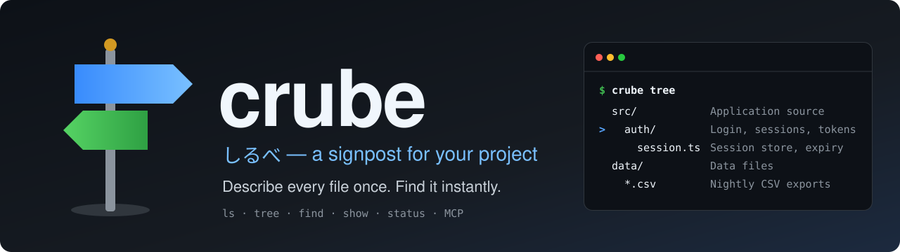

*[English](README.md) | **日本語***

<a id="top"></a>

<div align="center">



**ファイルとディレクトリに説明を付けて、説明付きの `ls` / `tree` / `find` で<br>目的の場所へすぐたどり着くための CLI と MCP サーバー**

[](https://github.com/amisonnet8/crube/actions/workflows/ci.yml)
[](https://github.com/amisonnet8/crube/releases)
[](LICENSE)
[](go.mod)
[](docs/reference/mcp_ja.md)

[デモ](#demo) · [特徴](#features) · [インストール](#install) · [はじめ方](#quick-start) · [使い方](#usage) · [AI エージェントと使う](#ai-agents) · [ドキュメント](#docs)

</div>

---

crube は、プロジェクト内のファイルとディレクトリに説明を付けて `.crube/` に保存し、説明付きの `ls` / `tree` / `find` で目的の場所へすぐたどり着けるようにするツールです。説明の作成・更新には AI を使えますが、参照するときに AI は要りません。

> [!NOTE]
> まだリリース前です（CLI と MCP サーバーは動きます）。ビルド済みのバイナリは、最初のリリースから GitHub Releases で配ります。今は `go install` で入れられます。

<a id="demo"></a>

## 🎬 デモ

<p align="center">
  
</p>

現在地に `>` の印を付ける `tree`、パスと説明から引く `find`、1 つのパスの詳細を見る `show`、説明の過不足を報告する `status`。この画像は、テストが crube の実際の出力から作っています。

<a id="features"></a>

## ✨ 特徴

- 🧭 **説明付きの `ls` / `tree` / `find`**：見慣れたコマンドに、説明が並ぶ。`tree` は現在地に印を付ける
- 🤖 **書くのは AI、引くのに AI は要らない**：説明の作成・更新は AI エージェントに任せられる。参照は保存済みのテキストだけで動く
- 🔒 **書き込むのは `.crube/` の中だけ**：プロジェクトのファイルは読むだけ。`rm`・`mv` も説明を消す・動かすだけ
- 📝 **人が読めるテキスト**：ディレクトリ構成をタブのインデントで書いた 1 ファイル。差分のレビューもしやすい
- 🩺 **鮮度のチェック**：`status` が未説明・孤立・上限超えを報告する。CI では `--require all|dirs` で止められる
- 🔌 **MCP サーバーを内蔵**：`crube mcp` で、シェルのない AI エージェントからも同じ機能を使える
- 🌐 **多言語**：言語ごとに独立したファイル（`structure_ja.txt` など）を、`CRUBE_LANG` で切り替える
- 📦 **単一バイナリ、Git に依存しない**：Go 製。Git も `.gitignore` も使わず、どこでも同じ結果になる

<a id="install"></a>

## 📦 インストール

```bash
go install github.com/amisonnet8/crube/cmd/crube@latest
```

Go 1.27 以降が要ります。

<a id="quick-start"></a>

## 🚀 はじめ方

```bash
cd your-project
crube init                                          # .crube/ を作る
crube set src/ "アプリケーションのソースコード"     # 説明を付ける
crube set "data/*.csv" "CSVデータ" --detail "毎晩、請求システムから書き出す"
crube status                                        # 説明の過不足を見る
crube tree                                          # 説明付きのツリーを見る
```

最初から最後まで通しで追うなら、[はじめての crube](docs/examples/getting-started_ja.md) へ。

<a id="usage"></a>

## 🧭 使い方

`tree` は structure ファイルの中身を、ファイルと同じ入れ子の形で見せ、現在地に `>` を付けます。

```console
$ cd src/auth
$ crube tree
  src/             アプリケーションのソースコード
>   auth/          認証(ログイン、セッション、トークン更新)
      session.ts   セッションの保存と有効期限の管理
      *_test.go    同名ファイルのテスト
    main.go        エントリポイント
  data/            データ格納場所
    *.csv          CSVデータ
```

`find` はパス・desc・detail から探します（大文字・小文字を区別しない、空白で区切った語の AND）。

```console
$ crube find セッション
src/auth/             認証(ログイン、セッション、トークン更新)
src/auth/session.ts   セッションの保存と有効期限の管理
```

`ls` は実在するファイルを、`show` は 1 つのパスの説明（detail まで）を見せます。

```console
$ crube ls src
auth/     認証(ログイン、セッション、トークン更新)
db/       ! no description
main.go   エントリポイント
$ crube show src/auth/session.ts
src/auth/session.ts
  desc    セッションの保存と有効期限の管理
  detail  セッションは Redis に保存し、アクセスのたびに有効期限を延長する。
          有効期限は config/auth.yaml の session.ttl で設定する。
```

| コマンド | 内容 |
| --- | --- |
| `crube init` | `.crube/` を作る |
| `crube ls [path]` | 実在するファイルの一覧を、説明付きで表示 |
| `crube tree [path] [-d N]` | structure の内容を表示し、現在地に印を付ける |
| `crube find <query>` | パス・説明で検索 |
| `crube show <path>` | 1 つのパスの全情報 |
| `crube status [--require all\|dirs]` | 実ディレクトリと structure の差分（未説明・孤立・上限超え・充足度） |
| `crube set <path> <desc> [--detail <text>]` | 説明の追加・更新 |
| `crube rm <path>` / `crube mv <from> <to>` | 説明の削除・付け替え（配下も含む。ファイルには触れない） |
| `crube mcp [--allow-write]` | MCP サーバーとして起動 |
| `crube completion <shell>` | bash・zsh・fish・PowerShell の補完スクリプトを出力（エントリのパスも TAB で補える） |

参照・編集のコマンドは `--json` で構造化した結果を出せます。詳しくは [CLI リファレンス](docs/reference/cli_ja.md)。

<a id="ai-agents"></a>

## 🤖 AI エージェントと使う

AI が説明を書き、人が `.crube/` の差分をレビューする、という分担を想定しています。

1. `crube status --json` で、説明が必要な場所を取り出す
2. AI がファイルを読み、`crube set` / `mv` / `rm`（または MCP の書き込みツール）で説明を直す
3. もう一度 `crube status` で、問題がなくなったことを確かめる

<details>
<summary><b>MCP クライアントへの登録例</b></summary>

```json
{
  "mcpServers": {
    "crube": {
      "command": "crube",
      "args": ["mcp", "--allow-write"],
      "env": { "CRUBE_LANG": "ja" }
    }
  }
}
```

`--allow-write` を外すと、参照のツール（`tree`・`ls`・`find`・`show`・`status`）だけを公開します。書き込みのツール（`set_description`・`remove_description`・`move_description`）も、書くのは `.crube/` の中だけです。詳しくは [MCP リファレンス](docs/reference/mcp_ja.md)。

</details>

<details>
<summary><b>エージェント向けの指示の例（CLAUDE.md など）</b></summary>

```markdown
## ファイルを探すとき
- まず `crube find <キーワード>` か `crube tree` で場所を確認する。

## 作業を終えるとき
- `crube status --json` を実行する。
- untracked / orphan があれば、ファイルを読んで
  `crube set` / `crube mv` / `crube rm` で説明を更新する。
- 自分がファイルを移動・改名した場合は、`crube mv <旧パス> <新パス>` で説明を付け替える。
```

</details>

<details>
<summary><b>CI で説明漏れを止める（GitHub Actions）</b></summary>

```yaml
- uses: actions/checkout@v7
- uses: actions/setup-go@v7
  with:
    go-version: stable
- name: Install crube
  run: go install github.com/amisonnet8/crube/cmd/crube@latest
- name: Check crube descriptions
  run: crube status --require dirs
```

`--require dirs` はすべてのディレクトリに、`--require all` はすべてのファイルとディレクトリに説明があることを求めます。どこまで求めるかは、プロジェクトが決めます。

</details>

<a id="docs"></a>

## 📚 ドキュメント

| | |
| --- | --- |
| 💬 [対話形式のガイド](https://notebook.google.com/notebook/201d48b7-45c8-4ba8-8853-d9c3b3181b8d) | 質問しながら crube を調べられる（Gemini Notebook 製） |
| 📖 [docs/README_ja.md](docs/README_ja.md) | 目次 |
| 🏛️ [docs/design/](docs/design/) | 設計（概要と基本方針、アーキテクチャ、データモデル、鮮度と充足度、決定事項） |
| 📐 [docs/reference/](docs/reference/) | 仕様（[CLI](docs/reference/cli_ja.md)、[MCP](docs/reference/mcp_ja.md)、[ファイル形式](docs/reference/file-format_ja.md)） |
| 🧪 [docs/examples/](docs/examples/) | 使い方の例（[はじめての crube](docs/examples/getting-started_ja.md)、[AI エージェントによる更新](docs/examples/ai-workflow_ja.md)） |

## 📄 ライセンス

[MIT](LICENSE)

---

<div align="center">
<sub><a href="#top">⬆ 先頭へ戻る</a></sub>
</div>
